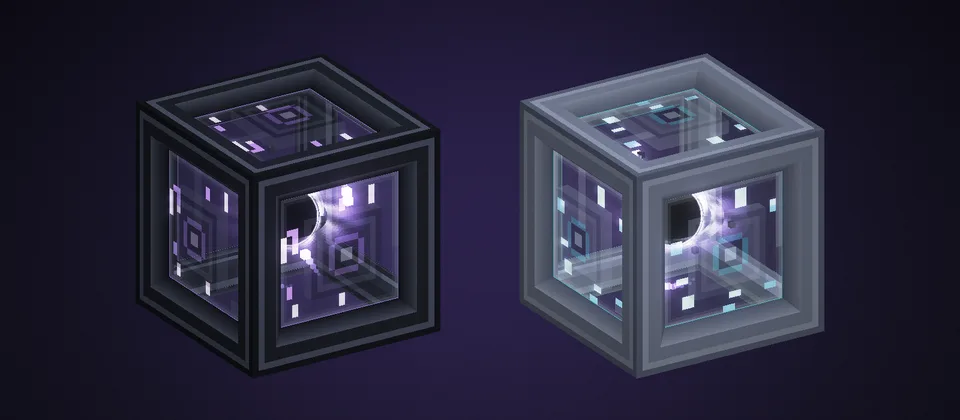

# AE2 无线收发器 · AE2 Wireless Transceiver (GTNH)

  

GT New Horizons 的 ME 无线连接方块。设成同一个**频率名**的收发器，它们所在的 ME 网络连为一体：不限距离，可跨维度，可多台互连。

适用 Minecraft 1.7.10。

[下载](https://github.com/peco331/AE2WirelessTransceiver-GTNH/releases/latest) · [更新日志](CHANGELOG.md) · [技术文档](docs/TECHNICAL.md) · [反馈问题](https://github.com/peco331/AE2WirelessTransceiver-GTNH/issues)

## 功能

- **频率配对**：不分主从，不用配对奇点。同一玩家的收发器选同一个频率即可互连。
- **32 频道**：每台收发器承载 32 个频道，本身不占频道，默认 10 AE/t，与距离无关。
- **定位**：列出一个频率下的全部收发器，在世界里透视高亮，并给出可点击的传送坐标。
- **命名**：每台收发器可单独命名，列表、定位和 Waila 中显示。
- **状态显示**：Waila 和界面直接写明收发器不工作的原因，如未设频率、被安全终端拒绝、网络无电。AE2 网络工具可显示无线连线。

## 版本支持

| GTNH | 模组版本 | 下载 | 维护 |
|---|---|---|:---:|
| 2.9.0-beta1 | 1.0.1 – 1.0.3 |  | ❌ |
| 2.9.0-beta2 | 1.0.4 – 1.0.6 |  | ❌ |
| 2.9.0-beta3 | 1.1.0 – 1.2.0 |  | ✔️ |
| 2.9.0-RC1 | 1.2.0 |  | ✔️ |

RC1 之后的 GTNH 版本未测试。

## 安装

把 `ae2wtx-*.jar` 放进客户端和服务端的 `mods` 文件夹，更新时移走旧版。

## 使用

**合成**：8 个 ME 量子环围一圈，中间放 1 个 ME 量子链接仓。

1. 在两处各放一台收发器，分别用 ME 线缆接上各自的网络。
2. 右键第一台，输入频率名（例如 `mining`），点 **新建**。
3. 右键第二台，选中 `mining`，点 **设为当前**。

两边的区块需要保持加载，网络需要有电。

- **断开**：只让这一台退出频率。
- **删除**：删掉整个频率，仅所有者或管理员可用，需点两次确认。
- **定位**：点 **收发器** 切换到当前频率的收发器列表，选中一台或多台（Ctrl 多选）后点 **定位**，高亮 60 秒；不选则高亮全部。聊天栏坐标可点击传送。
- **命名**：标题栏铅笔按钮。回车保存，Esc 取消，清空即删除，最多 32 字。铁砧改过名的收发器放下时直接使用该名字。
- **配色**：标题栏按钮，在“跟随默认 / 深色 / 浅色”之间切换。
- **扳手**：右键锁定 / 解锁，潜行右键拆卸。扳手拆下时保留名字和配色，镐挖掉则不保留。锁定后只有所有者或管理员能改名、换配色或拆卸。

## 频道占用率

8 个光点代表这个频率的全部容量，32 频道时每个光点 4 个频道。

- 亮起的数量为整个频率已用的频道，本机承担的部分更亮。
- 颜色：紫色正常，橙色超过 75%，红色已满。
- 离线时光点熄灭。

## 注意事项

- 无线连接遵守 AE2 的频道、供电和安全终端规则。普通线缆为 8 频道，跑满 32 频道需用致密线缆。
- 本模组不加载区块。
- 不同玩家的同名频率互不相通。关闭跨维连接后，频率按维度分开。
- 频道数按设备需求统计，缺频道的设备也计入，因此可能显示红色的 `33/32`。
- 相邻的两台收发器不会直接互连。

## 配置

`config/ae2wtx.cfg`，单人游戏也可在模组列表的 Config 中修改。

**客户端（`client`）**：只影响本机，在 Config 第一页修改，点“完成”立即生效。

| 选项 | 默认 | 作用 |
|---|---|---|
| `defaultTheme` | `dark` | 未单独选择配色的收发器使用深色（`dark`）或浅色（`light`） |
| `panelOpacity` | `100` | 接线面板不透明度，0~100%，按 10% 一档；0 为隐藏 |
| `glassArcs` | `true` | 在线时显示玻璃电弧 |
| `renderEffects` | `true` | 显示内部特效与频道光点 |
| `effectRenderDistance` | `32` | 特效显示距离（格） |
| `simpleBlockModel` | `false` | 改用普通方块外观 |
| `locateSeconds` | `60` | 定位高亮持续秒数（5~600） |
| `locateThroughWalls` | `true` | 定位高亮是否透过方块显示 |

**无线（`wireless`）**：在 Config 的“无线”子页，或编辑文件后重启。管理员可用 `/ae2wtx reload` 立即应用功耗和数量上限；跨维开关需要重启。

| 选项 | 默认 | 作用 |
|---|---|---|
| `wirelessCrossDimEnable` | `true` | 允许跨维度连接 |
| `wirelessTransceiverIdlePower` | `10.0` | 每台收发器的功耗，AE/t |
| `wirelessMaxBandsPerOwner` | `128` | 每位玩家的频率数量上限；关闭跨维后按维度计算 |
| `wirelessMaxBandsPerWorld` | `4096` | 整个存档的频率总数上限 |
| `pruneMissingTransceivers` | `true` | 自动清除已不存在的收发器记录（只检查已加载的区块） |

数量上限只限制新建，`0` 为禁止新建；调低上限不会删除已有频率。

## 许可

移植自 [ExtendedAE_Plus](https://github.com/GaLicn/ExtendedAE_Plus)（GaLicn），以 **LGPL-3.0** 发布。详见 [LICENSE](LICENSE) 和 [THIRD_PARTY_NOTICES.md](THIRD_PARTY_NOTICES.md)。

---

## English

A wireless ME connector for GT New Horizons (Minecraft 1.7.10). Supports GTNH 2.9.0 beta3 and RC1; later GTNH versions are untested.

### Features

Transceivers set to the same **frequency** name join their ME networks: no range limit, across dimensions, 32 channels each, 10 AE/t. The GUI lists and highlights every transceiver of a frequency, lets you name each one, and shows why a transceiver is offline (no frequency, denied by a security terminal, no power…).

### Usage

Craft one from 8 ME Quantum Rings around an ME Quantum Link Chamber. Right-click a transceiver, type a name and press **New**. Open the other transceiver, select the name and press **Apply**. Install on both client and server.

### License

LGPL-3.0, ported from [ExtendedAE_Plus](https://github.com/GaLicn/ExtendedAE_Plus) by GaLicn.
